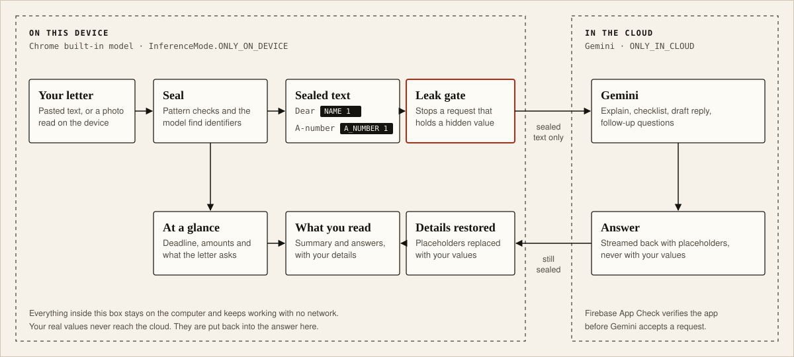

# Blackbar

Blackbar helps people who receive official letters in the United States (USCIS notices, landlord notices, university bills, insurance and bank letters) understand them without pasting their Social Security number, A-number, SEVIS ID, name or address into a chatbot. It is built for international students and immigrants. The letter is read and redacted in the browser by Chrome's built-in model, and only the redacted text can go to Gemini for a longer explanation, a checklist or a draft reply. When Gemini's answer comes back, the browser checks it against the full letter, which only the device has, and marks each statement it could or could not find there.

**Try it:** https://blackbar-8cba0.web.app (the on-device features need desktop Chrome; see Requirements).

**Demo video (3 minutes):** https://youtu.be/cZWINdaIIVE



## Model calls

Every call goes through the Firebase AI Logic SDK (`firebase/ai`). There is one model instance per feature, each with a fixed inference mode.

| Feature | Inference mode | Runs on | Why this side |
|---|---|---|---|
| Find identifiers (names, case and reference numbers) | `ONLY_ON_DEVICE`, JSON output through `onDeviceParams.promptOptions.responseConstraint` | Chrome built-in model | It reads the unredacted letter, so it must never fall back to the cloud. |
| At a glance (document type, sender, deadlines, amounts, what is asked) | `ONLY_ON_DEVICE`, JSON output | Chrome built-in model | Same reason. It also works offline. |
| Read a photo or scan | `ONLY_ON_DEVICE`, PNG or JPEG input | Chrome built-in model | The image contains every identifier. |
| Explain on this device | `ONLY_ON_DEVICE`, streamed | Chrome built-in model | Offered when the device is offline or a cloud request fails. It may read the full letter because nothing leaves the device. |
| Explain it plainly, What should I do next?, Draft a reply, follow-up questions | `ONLY_IN_CLOUD`, streamed, `gemini-3.5-flash-lite` | Gemini through Firebase AI Logic, with App Check | Longer answers in ten languages. It receives sealed text only, after the leak gate. |
| Check the answer against the letter | `ONLY_ON_DEVICE`, JSON output | Chrome built-in model, after code checks | Only the device has the full letter, so only the device can compare Gemini's answer with it. Nothing is sent. |
| Model download | `initializeDeviceModel()` | Chrome | Called only from the Download button. Opening a letter never starts a download. |

Each response's `inferenceSource` is shown in the privacy receipt. On-device results whose `inferenceSource` is not `on_device` are discarded.

## Privacy model

- **Sealing.** Pattern checks (`src/seal/detectors.ts`) find structured identifiers: SSNs, A-numbers, SEVIS IDs, USCIS receipt numbers, labelled passport, account, case, student and member numbers, phone numbers, email addresses, street addresses, ZIP codes, labelled dates of birth, and names after "Dear" or a label such as "Beneficiary:". The on-device model adds what patterns miss. A value the model returns is used only if it appears in the letter exactly as written. Dates other than a labelled date of birth are never barred, so deadlines stay readable.
- **Placeholders.** Each hidden value becomes a placeholder such as `⟦NAME_1⟧`. The same value always gets the same placeholder, and every place it appears is barred. The table from placeholder to value stays in the tab's memory.
- **What is sent.** The "What leaves this device" panel shows the exact sealed text before anything is sent. Follow-up questions are sealed the same way, and the panel shows the question as it will be sent. Sending pauses only while the on-device model is checking the letter. If a letter is sent before the model has checked it (because the model is not downloaded, or is still downloading), the answer and the receipt say it was sealed by pattern checks only.
- **Leak gate.** Before every cloud request, `leakCheck` (`src/seal/redact.ts`) searches the whole payload (instructions, letter, question and earlier answer) for every hidden value. It ignores letter case and finds copies with the spacing or punctuation removed. If it finds one, the request is not made and the reader sees which detail it was.
- **Restoring.** Answers arrive with placeholders. "Show my details" puts the real values back in the browser.
- **Checking the answer.** After each cloud answer, the browser checks it against the full letter (`src/check/`). It makes no network request; the e2e run asserts zero requests while it runs.
  1. The answer is split into statements, one per sentence of each paragraph or list item. Headings, greetings, questions, sentences with a gap for the reader to fill in, and the referral line are skipped.
  2. Code compares every date, amount and reference-like token (such as `I-765` or a phone number) in a statement with the letter, after normalising formats and restoring the hidden values on the device. A token that is not in the letter flags the statement: "Differs from your letter" when one or two adjacent letter sentences clearly cover the same point (they are shown), otherwise "Could not be matched".
  3. Code matches a statement to one or two adjacent letter sentences when they contain at least 70% of its content words (with light stemming, and acronyms such as "OPT" counted when the letter spells them out), and neither side negates what the other says. The threshold was chosen from measurement (see below).
  4. The rest go to the on-device model in batches of up to four, each with the closest window found by code and two more passages. The model sees hidden details only as labels such as "[A-number]". It can only find support, with up to two quotes. A "supported" verdict counts only if a quote is found in the letter (word for word, or one or two sentences holding at least 85% of its words), the quote shares at least 60% of the statement's content words, and the two agree on negation. Anything else is "Could not be matched". When a whole batch comes back unsupported, each statement is asked again on its own.
  5. An answer in another language than the letter cannot be compared word by word. Its statements are marked "Not compared"; their dates, amounts and references are still compared by code and can still be flagged.
  6. "Check a test answer with three planted mistakes", under the cloud buttons for a sample letter, loads a fixed answer written by Blackbar (not by Gemini) with a moved deadline, an invented fee and an invented requirement, and checks it the same way. It makes no request, and the receipt lists it as a test answer.
  7. Each checked paragraph or list item gets a mark. Pressing it shows the statement, the line in the letter, and "Show in the letter", which scrolls the sealed letter to that line. A summary line under the answer gives the counts, for example "8 of 9 statements matched to lines in your letter. 1 could not be matched; read it against the letter yourself." Without the device model, only steps 2 and 3 run and the answer says its wording was not checked.
- **Storage.** There are no accounts, no analytics and no server of our own. The letter lives in the tab's memory until the tab is closed or "Forget this letter" is pressed. The only thing written to the browser is the light or dark setting. The service worker caches the app's own files, never letter text.

**Limits.**
- The leak gate only knows values that have a bar. If both the patterns and the model miss an identifier, and the reader does not black it out, it is sent. This is why the reader reviews the bars before sending.
- Values shorter than six characters are matched exactly, so a reformatted short value is not caught.
- Gemini sees everything that is not barred: the sender, dates, amounts and the wording of the letter.
- Requests to Firebase carry the usual network metadata (IP address, App Check token).
- Model readings of photos can drop or change characters. The transcription is shown for correction before sealing.
- The answer check flags only what code can prove: a date, amount or reference that is not in the letter. It cannot prove that a reworded statement is wrong. About one correct English statement in four is left "Could not be matched", because it is worded too differently from the letter (see the measured numbers below).

## What is verified

`npm run e2e` runs headless Chrome with the real on-device model and writes [docs/e2e-results.json](docs/e2e-results.json) and [docs/screens/](docs/screens/). It checks:

- every listed identifier in each sample letter is barred, including one name that only the model can find;
- the deadline is correct and readable;
- every on-device call reports `on_device`, and no request leaves 127.0.0.1;
- the same checks after a reload with the network cut, with the app loaded by the service worker;
- a rendered image of a letter is transcribed and sealed on the device;
- real Gemini requests for each sample report `in_cloud`, and no request body contains an identifier;
- a follow-up containing a reformatted hidden value is blocked with no request made;
- selecting text and blacking it out bars every occurrence and updates the sealed text and the counts;
- keyboard-only use of the bars: Tab, Enter, Space, Peek, Keep visible, Black it out again, Escape, and focus returning to the bar;
- with a development-only test double for Chrome's model state:
  - not downloaded: opening a letter runs pattern checks at once, starts no download, offers the download, and a real Gemini request goes through and is marked as pattern-check sealing only;
  - Download pressed: progress to 100%, then the on-device model checks the letter and adds a bar for a name only it can find;
  - stalled at 0%: after 20 seconds the page says Chrome has not started the download and names disk space as the usual cause, offers a retry, and sending stays possible;
- the answer check, for every real Gemini answer: it finishes, and no request is made while it runs; "Show in the letter" scrolls the sealed letter to the quoted line;
- the test answer button on the USCIS sample: no request is made, the answer is labelled as a test, the receipt lists it as a test answer, and with the network cut during the check the moved deadline, the invented $85.00 fee and the invented requirement are all flagged (the deadline as "Differs from your letter", the other two as "Could not be matched"); one of its three correct statements, "USCIS sent this request for evidence about your Form I-765 application for optional practical training", is also left "Could not be matched";
- an axe-core accessibility scan of each state in light and dark;
- the "What leaves this device" panel stays in view beside long answers at desktop width.

`npm test` runs the unit tests: detectors, sealing, leak gate, question sealing, model-string mapping, deadlines, calendar files, chunking, prompts, the session state, and the answer check (statement splitting, token normalisation, passage selection, quote verification, verdict rules).

**Answer check, measured.** Real Gemini answers captured on 2026-11-19 for the three samples (an explanation, a checklist and a draft reply per letter, 47 English statements and 18 Spanish ones), plus 27 invented statements, 9 to 10 per letter, that the letters do not make and that contain no date, amount or reference. Both are in `src/check/fixtures.*.ts`; `src/check/eval.test.ts` re-measures the code part. With the real on-device model:

| | Earlier version (commit 3eff8a3), 2 rounds | Current version, 3 rounds |
|---|---|---|
| Correct English statements not matched | 10 to 15 of 47 (21% to 32%) | 12 to 14 of 47 (26% to 30%) |
| Invented statements marked as matched | 9 to 11 of 27 (33% to 41%) | 0 of 27 |
| Spanish statements | 6 to 7 of 18 marked "Not found" | all 18 "Not compared" |
| Three planted mistakes | all flagged | all flagged, also through the test answer button with the network cut |

I read every unmatched English statement by hand: all were correct, so they are false alarms. The earlier version's false passes came from the device model, which called invented statements "supported" with a real but unrelated quote; the quote-overlap and negation rules in step 4 stop that. Gemini made no factual mistake in these answers, so there was no real mistake to catch. The check took 2 to 20 seconds per answer on an Apple M3.

I also tried letting Gemini cite its sources: the sealed letter was sent with numbered lines, Gemini ended each statement with the line numbers it rested on, and the device compared each statement with the cited lines first. On six fresh answers (33 English statements) it left 14 of 33 unmatched in each of three rounds, with no invented statement matched, so it did not lower the unmatched rate and I removed it.

The first version asked the device model for a full verdict per statement (supported, not in the letter, or conflicts). It called some correct statements "conflicts", so only code can flag a statement.

**Not verified:**
- a complete first-time model download through this app (those states use a test double; the model on the test machine was installed beforehand);
- Windows, Linux and ChromeOS;
- photos of real paper letters (only a rendered image was tested);
- screen readers other than through axe-core and the keyboard checks;
- answer quality in languages other than English and Spanish;
- letters long enough to be split into parts with the real model (the splitting is unit-tested);
- the answer check on real mistakes by Gemini (none occurred in the measured runs; only planted mistakes were tested), on letters other than the three samples, and on invented statements other than the 27 used to choose the thresholds.

## Requirements

On-device features need desktop Chrome 139 or later with Chrome's built-in model. That means Windows 10 or 11, macOS 13 or later, Linux, or a Chromebook Plus, with about 22 GB of free disk space and either a GPU with more than 4 GB of memory or 16 GB of RAM and four CPU cores. The first download is about 2.5 GB.

Blackbar never downloads the model on its own. When Chrome reports the model as not downloaded, the Seal stage says that only pattern checks ran and offers a Download button. Chrome will not start the download with less than about 22 GB free; if the download shows no progress for 20 seconds, the page says so and offers a retry. When a download finishes, the model checks the letter that is open.

Without the on-device model, Blackbar still works with pattern checks only. Sending to Gemini is not blocked, names are not found automatically, and the reader can black out anything by hand. Photos cannot be read, there is no "At a glance" summary, and answers are checked by code only (dates, amounts, references and near-verbatim sentences), with a note that their wording was not checked.

## Setup and run

```bash
cp .env.example .env.local   # fill in the Firebase web app config
npm install
npm run dev                  # http://127.0.0.1:5183
npm test
npm run lint
npm run build                # dist/, with the service worker
npm run e2e                  # headless Chrome; see scripts/e2e.mjs
```

| Variable | Purpose |
|---|---|
| `VITE_FIREBASE_*` | Firebase web app config. |
| `VITE_RECAPTCHA_ENTERPRISE_SITE_KEY` | App Check provider for the hosted build. |
| `VITE_APPCHECK_DEBUG_TOKEN` | Development only. An App Check debug token registered in the Firebase console, for cloud calls from 127.0.0.1. Production builds replace it with an empty string. |
| `VITE_APPCHECK_DEBUG` | Development only. `true` makes the SDK print a new debug token to register. |
| `VITE_MOCK_CLOUD` | Development only. `true` replaces cloud answers with a stand-in labelled "Mock cloud response". Not included in production builds. |

Keep `.env.local` and debug tokens out of version control. `.gitignore` already excludes `.env.local`.

`npm run e2e` expects a Chrome profile that already has the model. It clones `../lab/.chrome-profile` into `.e2e-profile` using a copy-on-write clone.

Hosting configuration is in `firebase.json` (serves `dist/`, with no caching for `index.html` and `sw.js` and long caching for hashed assets) and `.firebaserc`.

## Project layout

- `src/seal/`: detectors, sealing and placeholders, leak check, question sealing, counts.
- `src/ai/`: Firebase and App Check setup, on-device calls (`device.ts`), cloud calls and the leak gate (`cloud.ts`, `cloudSender.ts`), prompts, glance validation.
- `src/check/`: the answer check: statements, tokens, passages, the verdict prompt, verdict rules and the runner.
- `src/lib/`: dates and deadlines, calendar (`.ics`) files, chunking for the 9,216-token on-device limit, transcription fixes, a small Markdown reader.
- `src/state/`: session state and hooks.
- `src/components/`: the three stages and the privacy receipt.
- `scripts/`: the service worker build plugin, the headless Chrome launcher and the e2e run.
- `docs/`: diagram, screenshots and e2e results.

## Built during the hackathon

All code in this repository was written from 2026-11-18 onward, during the #BuildHybridAI submission period. There is no code from before that date apart from the open-source dependencies listed in `package.json`. AI coding assistants were used during development.

## Not legal advice

Blackbar explains letters. It does not give legal advice, and its answers can be wrong. For questions about immigration status, ask your school's international student office or a qualified immigration attorney.

## License

Apache License 2.0. See [LICENSE](LICENSE).
